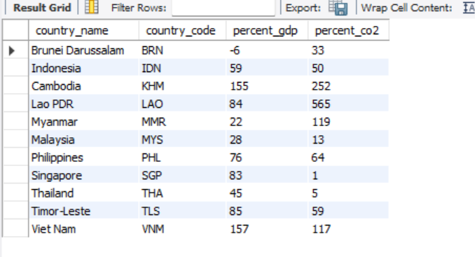
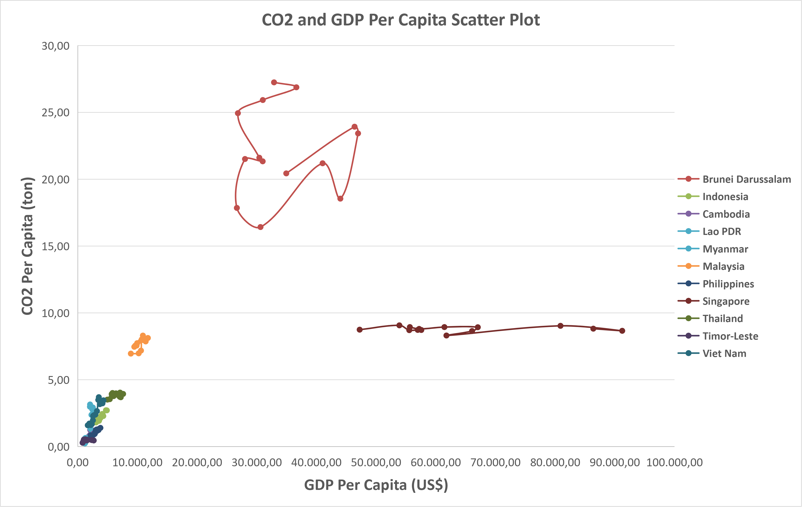

# GDP per Capita and CO2 Emissions per Capita in ASEAN (2010-2023)

## Research question
Is there a relationship between GDP per capita and CO2 emissions per capita
in ASEAN countries between 2010 and 2023?

## Data
- GDP per capita (current US$): World Bank, World Development Indicators
- CO2 emissions per capita: Our World in Data
- Scope: 11 ASEAN countries x 14 years = 154 observations

## Tools and workflow
1. **Excel (Power Query):** cleaned both files, reshaped GDP from wide to long
   format, split the CO2 file, filtered to ASEAN countries and 2010-2023.
2. **MySQL:** created tables, joined them on `country_code` and `year`
   (country names differ between sources), and calculated the percentage
   change from 2010 to 2023 for each country.
3. **Excel:** calculated Pearson correlation (CORREL) overall and per country,
   and built a scatter plot of GDP vs CO2 by country.

## Data quality note
Power Query read decimal points using Indonesian regional settings, which
inflated the CO2 values by a factor of millions. I detected this by comparing
the cleaned data against the source and fixed it by setting the locale to
English (US) when converting the data type.

## Key findings
- Overall correlation across all 154 observations: **0.64** (strong).
- **Very strong** (r >= 0.80): Indonesia, Cambodia, Philippines, Lao PDR, Vietnam.
- **Strong:** Malaysia (0.71), Myanmar (0.60).
- **Weak:** Thailand (0.38), Timor-Leste (0.20). Thailand's GDP per capita
  rose 45% from 2010 to 2023, while its CO2 per capita rose only 5%.
- **Almost no relationship:** Brunei (0.09) and Singapore (0.01).

## Limitations
This shows a statistical relationship, not causation. Each country has only
14 data points, and GDP is in current US$ (not adjusted for inflation).

## Files
- `gdp_asean.csv`, `co2_asean.csv`: cleaned data (11 ASEAN countries, 2010-2023)
- `file_asean_co2_gdp.sql`: SQL queries (table creation, join, percentage change)
- `asean_gdp_co2_project.xlsx`: Excel workbook with correlations and charts
- `summary_asean_co2_gdp.pdf`: one-page summary
